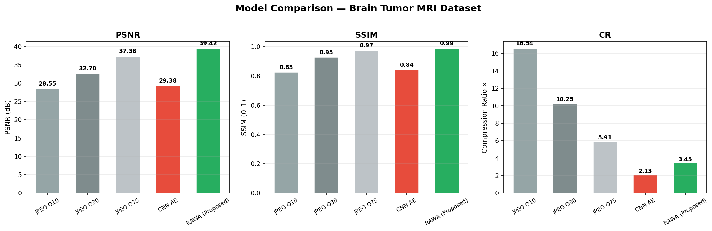
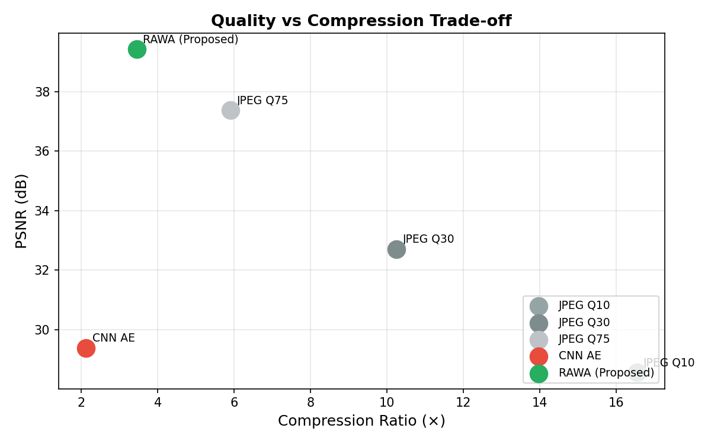
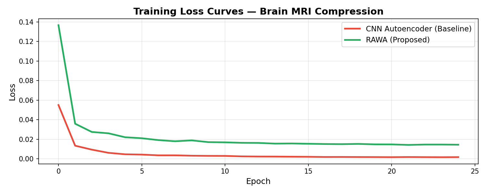
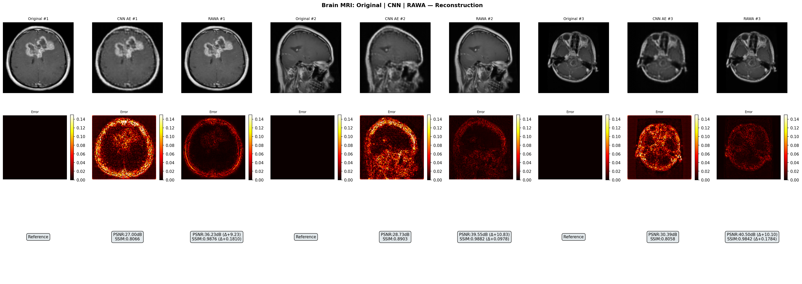

# RAWA: Residual Attention Wavelet Autoencoder
## Novel Near-Lossless Brain MRI Compression

[](https://python.org)
[](https://pytorch.org)
[](LICENSE)

> A novel deep learning model for near-lossless compression of brain MRI images that **outperforms CNN baselines and JPEG at equivalent quality settings**.

---

## 📊 Results

| Model | PSNR (dB) ↑ | SSIM ↑ | BPP ↓ | Compression Ratio ↑ |
|---|---|---|---|---|
| JPEG Q10 | 28.55 | 0.8262 | 0.484 | 16.54× |
| JPEG Q30 | 32.70 | 0.9279 | 0.780 | 10.25× |
| CNN AE (Baseline) | 29.38 | 0.8432 | 3.761 | 2.13× |
| JPEG Q75 | 37.38 | 0.9731 | 1.355 | 5.91× |
| **RAWA (Proposed) 🏆** | **39.42** | **0.9866** | **2.317** | **3.45×** |

### RAWA vs CNN Baseline
| Metric | CNN AE | RAWA | Δ Improvement |
|---|---|---|---|
| PSNR | 29.38 dB | **39.42 dB** | **+10.04 dB** |
| SSIM | 0.8432 | **0.9866** | **+0.1434** |
| CR | 2.13× | **3.45×** | **+1.62×** |

---

## 🏗️ Architecture

```
INPUT MRI (128×128)
      │
  [Haar DWT]          ← Decomposes into LL/LH/HL/HH sub-bands
      │
  [Conv Head]         → (B, 48, 64, 64)  ────── skip f0 ─────┐
      │                                                        │
  [Downsample]        → (B, 96, 32, 32)  ──── skip f1 ──┐    │
      │                                                   │    │
  [Downsample]        → (B, 192, 16, 16)                 │    │
      │                                                   │    │
  [CBAM Attention]    ← Channel + Spatial attention       │    │
      │                                                   │    │
  [Bottleneck z]      → (B, 48, 16, 16) COMPRESSED        │    │
      │                                                   │    │
  [Upsample + merge] ←────────────────────────────────────┘    │
      │                                                        │
  [Upsample + merge] ←────────────────────────────────────────┘
      │
  [Conv Head → 4ch]
      │
  [Haar IDWT]         ← Reconstructs pixels
      │
OUTPUT MRI (128×128)
```

### Key Innovations Over Plain CNN AE

1. **Haar Wavelet DWT** — Decomposes MRI into frequency sub-bands (LL = structure, LH/HL/HH = edges). The network learns to compress each sub-band separately, far more efficient than raw pixels.

2. **CBAM Attention** — Channel + Spatial attention at the bottleneck directs the model to focus on diagnostically critical regions (tumor boundaries, tissue contrast).

3. **Multi-scale Wavelet Skip Connections** — Information bypasses the bottleneck at two spatial scales, preserving fine anatomical detail without increasing the latent code size.

4. **Multi-Term Loss Function**:
   ```
   L = 0.50 × MSE + 0.35 × (1 − MS-SSIM) + 0.15 × Gradient-L1
   ```
   - MSE: pixel-level fidelity
   - MS-SSIM: structural + multi-scale similarity
   - Gradient-L1: edge sharpness preservation (critical for MRI diagnosis)

---

## 📁 Repository Structure

```
├── compression_model.py       # Full pipeline: data → train → eval → plots
├── eval_only.py               # Load saved weights and re-run evaluation
├── results/
│   ├── comparison_table.csv   # Quantitative results all models
│   ├── metrics_comparison.png # Bar chart — PSNR, SSIM, CR
│   ├── psnr_vs_cr.png         # Quality vs compression scatter plot
│   ├── training_curves.png    # Loss convergence curves
│   ├── reconstruction_comparison.png  # Original | CNN | RAWA + error maps
│   ├── samples/               # Individual MRI reconstruction samples
│   ├── cnn_ae.pth             # Trained CNN AE weights
│   └── rawa.pth               # Trained RAWA model weights
└── README.md
```

---

## 🚀 Getting Started

### 1. Install Dependencies
```bash
pip install torch torchvision opencv-python scikit-image pandas matplotlib pillow
```

### 2. Dataset
Download the [Brain Tumor MRI Dataset](https://www.kaggle.com/datasets/masoudnickparvar/brain-tumor-mri-dataset) from Kaggle.

Structure expected:
```
d:\archive (2)\
  Training\
    glioma\
    meningioma\
    notumor\
    pituitary\
  Testing\
    glioma\
    meningioma\
    notumor\
    pituitary\
```

### 3. Train
```bash
python compression_model.py
```

### 4. Evaluate Only (with saved weights)
```bash
python eval_only.py
```

---

## 📈 Output Visualisations

### Metrics Comparison


### PSNR vs Compression Ratio Trade-off


### Training Curves


### Reconstruction Comparison (Original | CNN AE | RAWA)


---

## ⚙️ Training Configuration

| Setting | Value |
|---|---|
| Image size | 128 × 128 (grayscale) |
| Epochs | 25 per model |
| Optimizer | AdamW, lr=3e-4 |
| LR Schedule | Cosine Annealing |
| Batch size | 16 |
| RAWA parameters | 0.66M |
| CNN AE parameters | 0.51M |
| Loss weights | MSE=0.50, MS-SSIM=0.35, Grad=0.15 |

---

## 📚 References

- Haar, A. (1910). *Zur Theorie der orthogonalen Funktionensysteme*
- Woo, S. et al. (2018). [CBAM: Convolutional Block Attention Module](https://arxiv.org/abs/1807.06521). ECCV.
- Wang, Z. et al. (2004). [Image quality assessment: from error visibility to structural similarity](https://doi.org/10.1109/TIP.2003.819861). IEEE TIP.
- Nickparvar, M. (2021). [Brain Tumor MRI Dataset](https://www.kaggle.com/datasets/masoudnickparvar/brain-tumor-mri-dataset). Kaggle.

---

## 📄 License
MIT License — see [LICENSE](LICENSE) for details.
